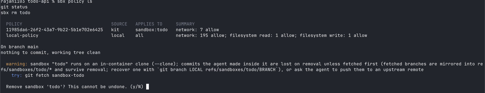
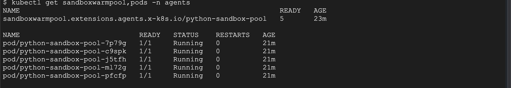
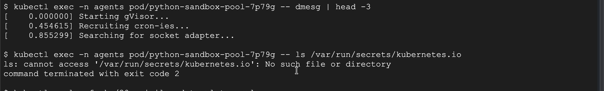
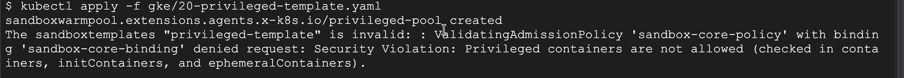
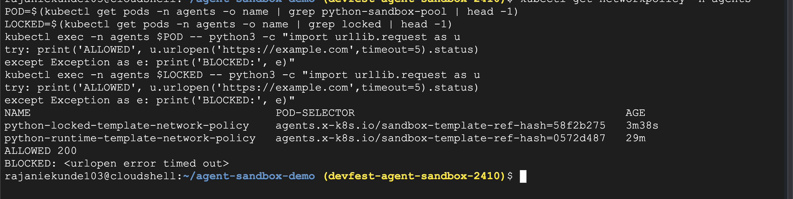

# Your Agent Just Ran `rm -rf`: Sandboxing AI Agents

Demo kit for sandboxing AI agents, from **Docker Sandboxes** on the laptop to **GKE Agent Sandbox** on the cluster.
By Rajani Ekunde and Rishi Mondal.

The idea in one line: **the limits live outside the agent.** Every guardrail below is enforced by the platform,
not by a prompt.

## What's verified

Both demos were run end to end on:
- Docker Sandboxes (`sbx` CLI) on macOS, Claude Code as the agent
- GKE Autopilot **1.37.1-gke.1697000** (RAPID channel), `asia-south1`, `--enable-agent-sandbox`

The ADK agent in `agent/` (one agent, two backends) and `loadtest.py` are included but were not part of the recorded demo.

## Repo layout

| Path | What it is |
| --- | --- |
| `todo-api/` | Small FastAPI app with tests. The agent's task in Demo 1. |
| `gke/00-cluster.sh` | Creates the Autopilot cluster, namespace, templates and warm pools |
| `gke/10-template.yaml` | Default `SandboxTemplate`: gVisor, non-root, no SA token, limits |
| `gke/11-warmpool.yaml` | Warm pool of 5 pods from that template |
| `gke/12-claim.yaml` | A manual `SandboxClaim`, to show the object model |
| `gke/20-privileged-template.yaml` | Same template + `privileged: true`. Rejected at admission |
| `gke/31-locked-template.yaml` | Same runtime, egress locked **in the template**: DNS only |
| `gke/99-cleanup.sh` | Deletes the cluster |
| `agent/` | ADK + Gemini agent with a `run_code` tool; `SANDBOX_BACKEND=docker\|gke` |
| `docs/screenshots/` | Stills from the recorded demo |

---

## Demo 1: Docker Sandboxes on the laptop (~60s)

```bash
brew install docker/tap/sbx          # Windows: winget install Docker.sbx
sbx login
cd todo-api && git init -q && git add . && git commit -qm start

sbx run --clone --name todo claude
```

On first run `sbx` asks for a network policy: **Open**, **Balanced** (deny by default, common dev sites allowed)
or **Locked Down**. Pick **Balanced**. Locked Down also blocks the agent's own model API.

Inside the sandbox, ask Claude:

```
Add a /health endpoint to app/main.py that returns {"status": "ok"}
```

It edits the code and runs the tests on its own, from `/home/agent/...`, inside the microVM. Then `/exit` and:

```bash
sbx policy ls     # the allowlist
git status        # on the host: "nothing to commit, working tree clean"
sbx rm todo       # sandbox gone
```

`--clone` gives the agent a private copy of the repo, so the host working tree is never touched.



---

## Demo 2 + 3: GKE Agent Sandbox (~90s)

### Setup (the night before, ~10 min)

```bash
export PROJECT_ID=<your-project>
bash gke/00-cluster.sh
kubectl get sandboxwarmpool,pods -n agents     # wait for the pods to be Running
```

### Inside a sandbox

```bash
kubectl get sandboxwarmpool,pods -n agents
POD=$(kubectl get pods -n agents -o name | grep python-sandbox-pool | head -1)
kubectl exec -n agents $POD -- dmesg | head -3
kubectl exec -n agents $POD -- ls /var/run/secrets/kubernetes.io
```

- Warm pods are already running, so a claim never waits on a cold start.
- `dmesg` prints **gVisor's own boot log** (`Starting gVisor...`), not the node's kernel log.
- No service account token is mounted, so code in the sandbox can't call the Kubernetes API.




### Guardrails the agent can't change

```bash
kubectl apply -f gke/20-privileged-template.yaml
```

Rejected at admission:

```
ValidatingAdmissionPolicy 'sandbox-core-policy' ... denied request:
Security Violation: Privileged containers are not allowed
```



### Egress is set by the template

```bash
kubectl get networkpolicy -n agents
LOCKED=$(kubectl get pods -n agents -o name | grep locked | head -1)
kubectl exec -n agents $POD -- python3 -c "import urllib.request as u
try: print('ALLOWED', u.urlopen('https://example.com',timeout=5).status)
except Exception as e: print('BLOCKED:', e)"
kubectl exec -n agents $LOCKED -- python3 -c "import urllib.request as u
try: print('ALLOWED', u.urlopen('https://example.com',timeout=5).status)
except Exception as e: print('BLOCKED:', e)"
```

```
ALLOWED 200
BLOCKED: <urlopen error timed out>
```



---

## Lessons from building this

- **Agent Sandbox manages egress per template.** For each `SandboxTemplate` it creates a managed `NetworkPolicy`.
  The default allows the public internet but blocks private ranges (`10/8`, `172.16/12`, `192.168/16`) and the
  metadata server (`169.254/16`), and only the sandbox router can connect in.
- **A separate deny `NetworkPolicy` doesn't help.** Network policies only add allows, so a namespace-wide deny
  can't override the template's allow rule. Lock egress in the template's `spec.networkPolicy` instead
  (see `gke/31-locked-template.yaml`).
- **The admission policy acts on the template itself.** A privileged template is rejected on `kubectl apply`,
  before any pod exists.
- **`--clone` matters on the laptop.** The default direct mount is read-write; clone mode keeps the host working
  tree clean.

## Cost and cleanup

Six small sandbox pods on Autopilot cost roughly $0.10–0.20 per hour, plus the cluster fee (often covered by
GKE's free tier). Delete the cluster when you're done:

```bash
bash gke/99-cleanup.sh
```

## Sources

- Docker Sandboxes: https://docs.docker.com/ai/sandboxes/ · CLI reference: https://docs.docker.com/reference/cli/sbx/
- GKE, enable Agent Sandbox: https://docs.cloud.google.com/kubernetes-engine/docs/how-to/how-install-agent-sandbox
- Agent Sandbox (kubernetes-sigs): https://agent-sandbox.sigs.k8s.io/
